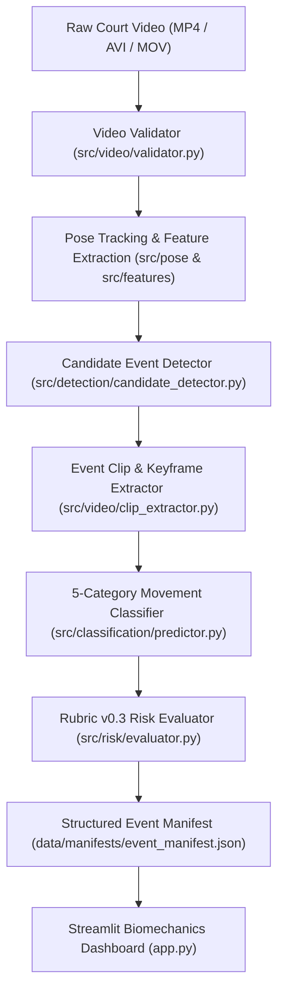

# AI-Based Badminton Movement Analysis & Injury-Risk Assessment System

An end-to-end sports biomechanics engineering prototype that processes badminton court video, automatically detects movement events, extracts individual action clips, classifies athletic movements across **5 categories**, and assesses lower-extremity and spinal joint risk under **Biomechanical Risk Rubric v0.3**.

---

## 🏗️ System Architecture & Workflow



---

## 🏸 Movement Categories & Biomechanical Rubric Scope

The system separates **Movement Category Classification** (*what movement occurred*) from **Biomechanical Risk Assessment** (*how it was executed relative to anatomical safety boundaries*):

| Movement Category | Status in Rubric v0.3 | Primary Biomechanical Metrics | Risk Scoring Behavior |
| :--- | :--- | :--- | :--- |
| **`LUNGE`** | **Active** | Lead knee flexion, knee-over-toe alignment, trunk forward lean | `PROVISIONAL (Unvalidated Cutoffs)` |
| **`SMASH_LANDING`** | **Active** | Jump landing knee cushioning, bilateral impact symmetry, lateral trunk tilt | `PROVISIONAL (Unvalidated Cutoffs)` |
| **`CHANGE_OF_DIRECTION`** | **Active** | Deceleration knee angle, braking stability, lateral trunk lean | `PROVISIONAL (Unvalidated Cutoffs)` |
| **`SCISSOR_JUMP`** | **Deferred** | Aerial leg swap displacement, flight elevation, torso rotation | `UNASSESSED (Rubric v0.3 Deferred)` |
| **`FOOTWORK_SPLIT_STEP`** | **Deferred** | Bilateral pre-hop bounce, stance expansion ratio | `UNASSESSED (Rubric v0.3 Deferred)` |

> [!IMPORTANT]
> **Active vs. Deferred Categories**:
> In accordance with **Biomechanical Risk Rubric v0.3** (see `docs/rubric_v0.3.md`), numerical indicator cutoffs remain unspecified and the H1 cluster-scoring hypothesis is unvalidated pending empirical biomechanical trials.
> Active categories report raw kinematic observations marked as **PROVISIONAL**. Discrete `LOW`, `MODERATE`, or `HIGH` risk decisions are **strictly disabled**.
> `SCISSOR_JUMP` and `FOOTWORK_SPLIT_STEP` are recognized movement categories whose risk criteria are deferred and marked as **UNASSESSED**. Missing measurements or low tracking confidence result in **UNCERTAIN**, never defaulting to low risk.

---

## 📁 Repository Structure

```text
Posture-detection-and-Injury-prediction-using-ML/
├── app.py                      # Unified Streamlit application entry point
├── app/
│   └── streamlit_app.py        # Streamlit biomechanics dashboard
├── src/
│   ├── video/                  # Video validation, subclip extraction, keyframes, pipeline
│   │   ├── validator.py
│   │   ├── clip_extractor.py
│   │   └── video_pipeline.py
│   ├── pose/                   # MediaPipe pose estimator and skeleton overlay rendering
│   │   ├── estimator.py
│   │   └── overlay.py
│   ├── features/               # Aspect-ratio corrected 2D angles, 3D world landmarks, aggregations
│   │   ├── angles_2d.py
│   │   ├── world_3d.py
│   │   └── aggregator.py
│   ├── detection/              # Candidate movement detector and structured manifest
│   │   ├── candidate_detector.py
│   │   └── manifest.py
│   ├── classification/         # 5 movement categories and model prediction service
│   │   ├── categories.py
│   │   └── predictor.py
│   ├── risk/                   # Biomechanical Risk Rubric v0.3 specification and evaluator
│   │   ├── rubric.py
│   │   └── evaluator.py
│   └── evaluation/             # Leakage-safe grouped splitting, Macro F1 metrics, confusion matrix
│       ├── split.py
│       └── metrics.py
├── training/
│   ├── compare_models.py       # Fair 3-model comparative evaluation (Random Forest vs Extra Trees vs SVM)
│   ├── train.py                # Single pipeline trainer
│   └── evaluate.py             # Model test evaluation utility
├── configs/
│   └── pipeline_config.json    # Pipeline thresholds and rubric configuration
├── docs/
│   ├── rubric_v0.3.md          # Comprehensive specification of Rubric v0.3
│   ├── Body part ids.txt       # MediaPipe 33 landmark mapping
│   └── Tech stacks.txt         # Technology stack reference
├── archive/                    # Reversibly preserved legacy scratch scripts
├── data/
│   ├── raw/                    # Source match videos (*.mp4, *.avi, *.mov - gitignored)
│   ├── processed/              # Processed video clips, keyframes, and overlays
│   ├── annotations/            # Human review verification decisions
│   └── manifests/              # Generated JSON event manifests
├── models/
│   ├── model_registry.json     # Active model registry and comparative validation scores
│   └── injury_risk_model.pkl   # Serialized winning pipeline artifact
├── tests/                      # Full unit, integration, and failure test suite (50 tests)
├── requirements.txt            # Python package dependencies
└── README.md                   # System documentation
```

---

## 🚀 Quickstart & Usage Guide

### 1. Environment Requirements
- Python 3.10 to 3.12 (tested on Linux x86_64)
- OpenCV and MediaPipe Tasks API
- FFmpeg (optional, recommended for web H.264 video encoding)

```bash
# Clone the repository
git clone https://github.com/Pavanhs-123/Posture-detection-and-Injury-prediction-using-ML.git
cd Posture-detection-and-Injury-prediction-using-ML

# Create virtual environment and activate
python3 -m venv .venv
source .venv/bin/activate

# Install dependencies
pip install -r requirements.txt
```

### 2. Launch the Streamlit Dashboard

Run either entry point:
```bash
streamlit run app.py
```
*(or `streamlit run app/streamlit_app.py`)*

In the dashboard:
1. **Upload Video**: Drag and drop an MP4, AVI, or MOV court video.
2. **Inspect Metadata**: Review duration, FPS, resolution, and decodability.
3. **Execute Pipeline**: Click `Process Video Pipeline` to extract events, generate skeleton overlays, and slice action clips.
4. **Inspect Events**: Use the event selector to watch individual movement clips and view representative keyframes.
5. **Review Biomechanics**: Examine measured joint angles, classification probabilities, and Rubric v0.3 risk assessments.
6. **Download Artifacts**: Export the structured event manifest (`manifest.json`) or CSV summary.

---

## 🧪 Model Training & 3-Model Comparison Workflow

The comparative ML framework compares three model families:
1. **Random Forest**: Tabular tree ensemble baseline (`RandomForestClassifier`)
2. **Extra Trees**: Extremely randomized ensemble (`ExtraTreesClassifier`)
3. **Support Vector Machine (SVM)**: RBF kernel with standard scaling (`SVC(probability=True)`)

### End-to-End Dataset Assembly and Training Workflow:
1. **Launch the Dashboard**: Start the interface (`streamlit run app.py`).
2. **Upload & Extract**: Process court video files to detect candidate intervals and extract clips.
3. **Human Review & Annotation**: Review proposed events using `review_candidates.py` to confirm movement categories and assign player IDs. Unreviewed or rejected events are excluded.
4. **Assemble Event-Level Dataset**: Export the approved annotations into a CSV file (e.g. `data/assembled_dataset.csv`).
5. **Grouped Independence Validation**: Ensure the dataset contains at least **3 independent groups** (`player_id` if available, or `video_id`). At least 3 independent groups are required to isolate train, validation, and test partitions without leakage.
6. **Execute Comparative Training**:
   ```bash
   python training/compare_models.py \
       --data data/assembled_dataset.csv \
       --target movement_type \
       --output-dir models/ \
       --seed 42
   ```
7. **Evaluate Winner on Holdout Test Set**: The framework automatically isolates the test set during candidate selection, evaluates the winning candidate on holdout data, and writes metrics.
8. **Automated Registration**: The selected best model is saved to `models/model_registry.json` and automatically loaded by the Streamlit application.

> [!NOTE]
> `data/dataset.csv` is not pre-packaged with the repository. A real dataset must be assembled from annotated videos before training. Synthetic test fixtures in `tests/` are reserved exclusively for automated software verification.

---

## 🔬 Testing & Quality Assurance

Run the complete test suite (50 passing tests):
```bash
.venv/bin/python -m unittest discover -s tests -p "*test*.py" -v
```

### Test Coverage Highlights:
- **Video Validation**: Corrupt files, unsupported extensions, 0-byte files, valid MP4s (`tests/test_video_pipeline.py`).
- **Clip & Keyframe Extraction**: Temporal subclip slicing and keyframe rendering (`tests/test_video_pipeline.py`).
- **5 Movement Categories**: Enforces schema and active vs. deferred rubric status (`tests/test_video_pipeline.py`).
- **3-Model Comparison**: Grouped leakage prevention, Macro F1 calculation, pipeline training (`tests/test_model_comparison.py`).
- **Kinematic Candidate Detection**: Jump apex detection, lunge hip drops, deceleration reversals (`tests/test_candidate_detector.py`).
- **2D/3D Biomechanics**: Aspect-ratio Euclidean scaling, 3D world landmark angles (`tests/test_2d_3d_features.py`).

---

## ⚠️ Prototype Scope & Limitations

> [!WARNING]
> **Academic Engineering Prototype Disclaimer**:
> This software is an **academic engineering prototype** designed to explore computer-vision-based movement candidate proposal and posture screening in badminton. It is **NOT** a certified medical diagnostic device, clinical injury prediction system, or substitute for professional sports medicine evaluation.
>
> 1. **Screening vs. Clinical Diagnosis**: Joint angles exceeding safety limits indicate kinematic strain, not an inevitable pathology or medical diagnosis.
> 2. **Camera Angle Effects**: 2D angles are subject to perspective foreshortening. Fixed 90° lateral tripod recording is required for planar sagittal joint kinematics.
> 3. **Monocular 3D Landmarks**: MediaPipe's `pose_world_landmarks` are single-camera metric depth estimates; they are not motion-capture ground truth.
