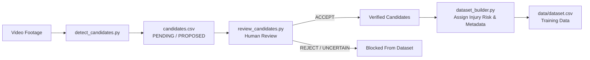

# AI-Based Badminton Posture Detection & Injury-Risk Assessment System

This repository contains the codebase for our major project: **AI-Based Badminton Posture Detection & Injury-Risk Assessment System**.

The application extracts biomechanical features (knee flexion, elbow extension, and torso/trunk angles) from badminton video sequences using **MediaPipe Pose Landmarker**, aggregates them into sequence-level metrics, and classifies the posture sequence as **LOW**, **MODERATE**, or **HIGH** injury-risk.

---

## 📸 Data Collection Protocol & Camera Setup

To ensure consistent pose estimations, reliable biomechanical measurements, and avoid perspective distortions, all input videos should adhere to the following data collection protocol:

1.  **Camera Placement (Preferred)**: Position the camera at a **fixed side view**, approximately **90°** relative to the player's primary sagittal movement plane.
2.  **Mounting & Stability**: Keep the camera static (fixed on a rigid tripod) and avoid handheld panning, tilting, or zooming.
3.  **Height**: Set the camera height between **1.2 to 1.5 meters** from the floor (approx. hip level).
4.  **Framing & Foot Visibility**: Ensure the player's **entire body and both feet** are clearly visible in the frame throughout the entire movement. Foot contact and plant phase are vital for lunge and landing assessment.
5.  **Recording Resolution**: Record in landscape orientation (16:9 ratio, preferably **1080p at 30+ FPS**).
6.  **Camera Viewpoint Metadata**: Always record the camera viewpoint as metadata (`camera_viewpoint`: `side_90deg`, `diagonal_45deg`, `front_view`, `rear_view`, `broadcast_free`).
7.  **3D Landmark Perspective Advisory**:
    > [!IMPORTANT]
    > **3D Landmarks Do NOT Eliminate Camera-Angle Effects**:
    > MediaPipe's `pose_world_landmarks` provide monocular metric estimates that reduce planar foreshortening, but monocular depth prediction remains sensitive to non-perpendicular angles and out-of-plane rotations. Adhering to the fixed 90° side-view protocol remains essential for high-fidelity joint kinematics.

---

## 🏸 Target Movement Classes

The system focuses on exactly three high-impact badminton movements associated with lower-extremity and trunk stress:

1. `LUNGE`: Deep unilateral forward/lateral step with substantial knee flexion ($\le 120^\circ$), wide stance ratio ($\ge 0.70$), knee asymmetry ($\ge 20^\circ$), and hip depression.
2. `SMASH_LANDING`: Aerial elevation above baseline ($\ge 0.045$), vertical velocity reversal, overhead arm/racquet extension ($\min(y_{wrist}) < y_{shoulder} - 0.05$), and deceleration knee flexion impact ($\le 140^\circ$).
3. `CHANGE_OF_DIRECTION`: Rapid lateral approach speed ($|v_x| \ge 0.16$), sharp velocity sign reversal, and braking plant knee flexion ($\le 150^\circ$).

> [!NOTE]
> **Retired Classes (`SCISSOR_JUMP` & `FOOTWORK_SPLIT_STEP`)**:
> `SCISSOR_JUMP` and `FOOTWORK_SPLIT_STEP` have been removed as independent target classes to maintain rigorous data collection standards and avoid false positives. They are **never silently re-mapped** to another class. If an observed movement does not clearly match one of the three target classes, it must be marked `UNCERTAIN` or `NO_EVENT` for human review.

---

## 📁 Project Structure

```text
Posture-detection-and-Injury-prediction-using-ML/
├── app/
│   └── streamlit_app.py        # Streamlit web application dashboard
├── data/
│   ├── clips/                  # Labeled movement clip video files
│   ├── landmarks/              # Raw MediaPipe joint coordinate files (JSON)
│   ├── candidates.csv          # Proposed candidate movements from detector
│   └── dataset.csv             # Labeled sequence feature dataset
├── models/
│   └── injury_risk_model.pkl   # Serialized trained model (Scikit-learn pipeline)
├── src/
│   ├── detection/
│   │   ├── __init__.py
│   │   └── candidate_detector.py # Rule-based movement candidate proposal engine
│   ├── inference/
│   │   ├── __init__.py
│   │   └── pipeline.py         # Video pipeline and pose overlays
│   └── model/
│       ├── __init__.py
│       ├── integration_test_model.py # Demo Mode model
│       └── interface.py        # Model abstraction loader
├── tests/
│   ├── test_2d_3d_features.py  # 2D vs 3D pose extraction tests
│   ├── test_candidate_detector.py # Candidate proposal unit tests
│   ├── test_candidate_review.py   # Human review and contamination tests
│   └── test_pipeline.py        # Pipeline & integration test suite
├── compare_2d_3d.py            # 2D vs 3D landmark angle comparison CLI
├── detect_candidates.py        # Automatic candidate detector CLI
├── review_candidates.py        # Human review terminal workflow CLI
├── dataset_builder.py          # Sequence dataset annotation tool
├── main.py                     # Real-time webcam joint angles overlay tool
├── pose_analysis.py            # Joint angle and torso lean mathematics
├── train.py                    # Grouped train/test split model training script
├── requirements.txt
└── README.md
```

---

## ⚡ Install & Setup

Create a Python 3.10+ virtual environment and install the dependencies:

```bash
python -m venv .venv
source .venv/bin/activate
pip install -r requirements.txt
```

---

## 💾 Dataset & Labeling Workflow

The system represents movement sequences rather than independent frames. **ONE ROW = ONE MOVEMENT SEQUENCE**.

### 1. Run the Dataset Creator
To clip and annotate movement sequences from a video:

```bash
python dataset_builder.py --video /path/to/video.mp4 --start-time 2.5 --end-time 4.8 --sample-fps 10 --camera-viewpoint side_90deg
```

If start/end times are omitted, the script will prompt for them in the console.

### 2. Annotation Actions
*   The script runs pose estimation, aggregates sequence metrics, and plays the clip in an OpenCV loop.
*   In the console, choose from the three target movement types:
    *   `LUNGE`, `SMASH_LANDING`, `CHANGE_OF_DIRECTION`.
*   Assign the expert risk label:
    *   `LOW`, `MODERATE`, `HIGH` (strictly manual; never auto-assigned from movement class).
*   Rows are appended directly to `data/dataset.csv`, raw 33 landmarks for all frames are saved in `data/landmarks/{seq_id}.json` (with `camera_viewpoint`), and the clip is stored in `data/clips/{seq_id}.mp4`.

---

## 🔍 Stage 1: Evaluate 2D vs 3D Pose Features

To evaluate whether MediaPipe's `pose_world_landmarks` (3D metric coordinates) provide more consistent joint angles than normalized 2D landmarks:

```bash
python compare_2d_3d.py --video /path/to/badminton_clip.mp4 --output-csv data/comparison_2d_3d.csv --sample-fps 10
```

---

## 🎯 Stage 2: Automatic Movement Candidate Detector & Human Review

Scan a badminton game or practice video to automatically propose candidate movement timestamps (`LUNGE`, `SMASH_LANDING`, `CHANGE_OF_DIRECTION`):

```bash
python detect_candidates.py --video /path/to/match.mp4 --output-csv data/candidates.csv --export-clips --fps 15
```

> [!IMPORTANT]
> **Heuristic Scores are NOT Probabilities**:
> Scores generated by `detect_candidates.py` are uncalibrated rule-matching heuristic scores (0.0 to 1.0) based on biomechanical signals. They are intended for proposing correct, human-verifiable candidates without artificially inflating candidate counts. Candidates must undergo human review before entering the training dataset.

### Candidate CSV Schema
The generated `data/candidates.csv` includes:
* `candidate_id`: Unique identifier (e.g., `cand_001`).
* `video_id`: Source video filename.
* `start_time`, `end_time`, `duration`: Candidate time boundaries in seconds.
* `proposed_movement`: Movement class proposal (`LUNGE`, `SMASH_LANDING`, `CHANGE_OF_DIRECTION`, or `UNCERTAIN`).
* `heuristic_score`: Uncalibrated rule-match score (0.0 - 1.0).
* `key_metrics`: JSON-formatted triggering signals (e.g., knee flexion, stance ratio, overhead arm detection, hip drop).
* `human_decision`: Review status (`PENDING`, `ACCEPT`, `REJECT`, `UNCERTAIN`).
* `reviewed_movement`: Ground-truth movement class confirmed or corrected by the reviewer.
* `reviewer_notes`: Optional reviewer annotations.

### End-to-End Human Review & Labeling Workflow



#### Step 1: Detect Movement Candidates
```bash
python detect_candidates.py --video data/videos/match.mp4 --output-csv data/candidates.csv --export-clips
```

#### Step 2: Human Review & Reclassification Tool
Inspect candidate proposals, view diagnostics, and accept, reject, or correct classes:
```bash
# View diagnostic summary table
python review_candidates.py --summary --candidates-csv data/candidates.csv

# Run interactive review terminal workflow
python review_candidates.py --candidates-csv data/candidates.csv
```
Review controls:
* `[A]` **Accept** candidate (confirms proposed class).
* `[C]` **Correct** class (reclassify to one of the 3 target classes, `NO_EVENT`, or `UNCERTAIN`).
* `[R]` **Reject** candidate (false positive, non-badminton movement, or discarded).
* `[U]` Mark **Uncertain** (cannot determine from video/posture).
* `[S]` **Skip** to next candidate without decision.
* `[Q]` **Quit** and save all progress.

#### Step 3: Dataset Builder with Contamination Prevention
Load reviewed candidates, specify viewpoint metadata, and manually assign injury risk labels:
```bash
python dataset_builder.py --video data/videos/match.mp4 --candidates-csv data/candidates.csv --camera-viewpoint side_90deg
```

**Dataset Contamination Prevention Safeguards:**
* 🚫 **Unreviewed Candidates Blocked**: Candidates with `human_decision == "PENDING"` cannot enter `dataset.csv` without explicit reviewer review and confirmation.
* 🚫 **Retired Classes Blocked**: Retired classes (`SCISSOR_JUMP`, `FOOTWORK_SPLIT_STEP`) cannot enter the dataset. They must be reclassified to one of the 3 target classes or rejected.
* 🚫 **Rejected & Uncertain Candidates Blocked**: Samples marked as `REJECT` or `UNCERTAIN` are strictly blocked.
* 🚫 **Overlapping Sample Detection**: Warns and prevents duplicate overlapping clips ($\ge 0.4$s overlap) from the same video from being saved twice.
* ⚖️ **Human-in-the-Loop Risk Labeling**: Injury risk labels (`LOW`, `MODERATE`, `HIGH`) are strictly assigned by human analysts following established biomechanical criteria—they are never automated from movement type.


---

## 🏋️ Model Training

To train the Random Forest Classifier on the compiled dataset, execute:

```bash
python train.py --csv data/dataset.csv --output models/injury_risk_model.pkl
```

### Data Leakage Prevention
The training script splits data based on the source `video_id` (representing different players/runs) rather than random rows. This ensures that movement sequences originating from the same video file never appear in both the training and test datasets.

---

## 🔌 Model Plug-in Process

Once data labeling is complete and `train.py` exports the model:

1.  Place the generated `injury_risk_model.pkl` in the `models/` directory.
2.  Start the Streamlit application.
3.  The sidebar will display `✅ Real Model Loaded` and switch active inference to the trained Scikit-learn model pipeline.

---

## 🖥️ Streamlit Web Application

To run the full-stack web dashboard interface:

```bash
streamlit run app/streamlit_app.py
```

### Features
*   **Video Upload**: Supports MP4, AVI, and MOV files.
*   **Time Slicing**: Set start and end boundaries to extract a specific movement sequence.
*   **Skeletal Overlays**: View the processed video containing drawing joint points and lines.
*   **Gauges & Metrics**: Renders calculated minimum knees and elbows flexions, and maximum torso lean.
*   **Explanation Panel**: Generates structured anatomical explanations explaining the injury-risk score.
*   **Demo Mode**: Automatically falls back to the threshold-based `IntegrationTestModel` if no real model is present, allowing end-to-end testing.
*   **History Logs**: Displays a local history table of past analyzed videos powered by SQLite (`data/history.db`).

---

## 🧪 Running Unit Tests

Run the test suite verifying mathematical calculations, models, and file pipelines:

```bash
python -m unittest discover -s tests -v
```

---

## 🔬 Clinical Scope vs. Engineering Screening Prototype

> [!WARNING]
> **Engineering Prototype Disclaimer**:
> This software is an **academic engineering prototype** designed to explore computer-vision-based movement candidate proposal and posture screening in badminton. It is **NOT** a certified medical diagnostic device, clinical injury prediction system, or substitute for professional sports medicine evaluation.
>
> * **Movement Classification vs. Injury Risk**: Movement classification (`LUNGE`, `SMASH_LANDING`, `CHANGE_OF_DIRECTION`) identifies the athletic pattern. Injury risk (`LOW`, `MODERATE`, `HIGH`) represents joint flexion and alignment compliance with published sports science guidelines. One does not automatically dictate the other.
> * **Heuristic Scores**: Scores produced during candidate proposal are uncalibrated rule-matching confidence indicators (0.0 to 1.0), not Bayesian or clinical probabilities.
> * **Demo Mode**: The fallback `IntegrationTestModel` simulates classification using textbook anatomical thresholds for pipeline integration testing; it is not a trained clinical classifier.

---

## 📋 Known Limitations & Validation Status

| Subsystem | Status | Scope & Validation Notes |
| :--- | :--- | :--- |
| **2D Joint Angles & Torso Lean** | ✅ Validated | Mathematical angle calculations verified with Euclidean pixel-space aspect ratio scaling across test vectors. |
| **3D World Landmark Comparison** | ✅ Validated | 3D metric coordinate vector calculations verified. Monocular 3D estimation reduces planar foreshortening but remains sensitive to non-perpendicular viewpoints. |
| **Candidate Detection (3 Classes)** | ✅ Validated | Verified on synthetic and sample footage. Calibrated to propose human-verifiable candidates for `LUNGE`, `SMASH_LANDING`, and `CHANGE_OF_DIRECTION`. |
| **Human Review Workflow** | ✅ Validated | Interactive workflow tested with overlap detection, status persistence, and strict blocking of unreviewed and retired classes. |
| **Grouped Model Training** | ✅ Validated | Grouped video splitting verified to eliminate intra-video player data leakage. Tested on small and single-class edge cases. |
| **Streamlit Web Application** | ✅ Validated | End-to-end interface verified with skeletal overlay rendering, metrics display, dynamic biomechanical explanations, and SQLite history logging. |
| **Clinical Motion-Capture Ground Truth** | ⏳ Unvalidated | Requires multi-camera optical motion capture (e.g., Vicon / Qualisys) and force plate data for clinical kinematic validation. |
| **Trained Production Model** | ⏳ Pending Data | Requires collecting and labeling a diverse multi-player badminton video dataset using `dataset_builder.py` before training the final production classifier. |
