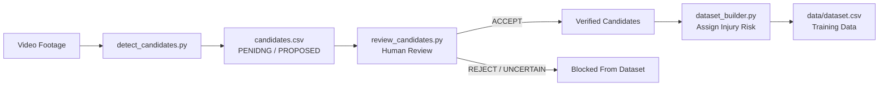

# AI-Based Badminton Posture Detection & Injury-Risk Assessment System

This repository contains the codebase for our major project: **AI-Based Badminton Posture Detection & Injury-Risk Assessment System**.

The application extracts biomechanical features (knee flexion, elbow extension, and torso/trunk angles) from badminton video sequences using **MediaPipe Pose Landmarker**, aggregates them into sequence-level metrics, and classifies the posture sequence as **LOW**, **MODERATE**, or **HIGH** injury-risk.

---

## 📸 Camera & Recording Protocol

To ensure consistent 2D pose estimations and avoid angle distortions, all input videos should adhere to the following setup guidelines:

1.  **Camera Placement**: Position the camera at a **side view**, approximately **90°** relative to the player's movement plane.
2.  **Height**: Set the camera height between **1.2 to 1.5 meters** from the floor.
3.  **Orientation**: Record in **landscape** orientation (16:9 ratio, preferably **1920×1080** resolution).
4.  **Framing**: Ensure the player's entire body is visible from head to toe within the frame at all times.
5.  **Camera Stability**: Keep the camera static (fixed on a tripod) and avoid tilting.

---

## 📁 Project Structure

```text
Posture-detection-and-Injury-prediction-using-ML/
├── app/
│   └── streamlit_app.py        # Streamlit web application dashboard
├── data/
│   ├── clips/                  # Labeled movement clip video files
│   ├── landmarks/              # Raw MediaPipe joint coordinate files (JSON)
│   └── dataset.csv             # Labeled sequence feature dataset
├── models/
│   └── injury_risk_model.pkl   # Serialized trained model (Scikit-learn pipeline)
├── src/
│   ├── inference/
│   │   ├── __init__.py
│   │   └── pipeline.py         # Video pipeline and pose overlays
│   └── model/
│       ├── __init__.py
│       ├── integration_test_model.py # Demo Mode model
│       └── interface.py        # Model abstraction loader
├── tests/
│   └── test_pipeline.py        # Unit test suite
├── dataset_builder.py          # Sequence dataset annotation tool
├── main.py                     # Real-time webcam joint angles overlay tool
├── pose_analysis.py            # Joint angle and torso lean mathematics
├── train.py                    # Training template (Random Forest Classifier)
├── requirements.txt
└── README.md
```

---

## ⚡ Install & Setup

Create a Python 3.10+ virtual environment and install the dependencies:

```bash
python -m venv .venv
source .venv/bin/activate
pip install -r requirements.txt
```

---

## 💾 Dataset & Labeling Workflow

The system represents movement sequences rather than independent frames. **ONE ROW = ONE MOVEMENT SEQUENCE**.

### 1. Run the Dataset Creator
To clip and annotate movement sequences from a video, run:

```bash
python dataset_builder.py --video /path/to/video.mp4 --start-time 2.5 --end-time 4.8 --sample-fps 10
```

If start/end times are omitted, the script will prompt for them in the console.

### 2. Annotation Actions
*   The script runs pose estimation, aggregates sequence metrics, and plays the clip in an OpenCV loop.
*   In the console, choose the movement type:
    *   `LUNGE`, `SMASH_LANDING`, `SCISSOR_JUMP`, `CHANGE_OF_DIRECTION`, `FOOTWORK_SPLIT_STEP`.
*   Assign the expert risk label:
    *   `LOW`, `MODERATE`, `HIGH`.
*   Rows are appended directly to `data/dataset.csv`, raw 33 landmarks for all frames are saved in `data/landmarks/{seq_id}.json`, and the clip is stored in `data/clips/{seq_id}.mp4`.

---

## 🔍 Stage 1: Evaluate 2D vs 3D Pose Features

To evaluate whether MediaPipe's `pose_world_landmarks` (3D metric coordinates) provide more consistent joint angles than normalized 2D landmarks:

```bash
python compare_2d_3d.py --video /path/to/badminton_clip.mp4 --output-csv data/comparison_2d_3d.csv --sample-fps 10
```

### Output Schema (`data/comparison_2d_3d.csv`)
*   `video_id`, `sequence_id`, `frame_index`, `timestamp_sec`, `pose_detected`
*   `left_knee_2d`, `left_knee_3d`, `left_knee_diff` ($\Delta = \text{angle}_{3D} - \text{angle}_{2D}$)
*   `right_knee_2d`, `right_knee_3d`, `right_knee_diff`
*   `left_elbow_2d`, `left_elbow_3d`, `left_elbow_diff`
*   `right_elbow_2d`, `right_elbow_3d`, `right_elbow_diff`
*   `trunk_angle_2d`, `trunk_angle_3d`, `trunk_angle_diff`
*   `left_knee_conf`, `right_knee_conf`, `left_elbow_conf`, `right_elbow_conf`, `torso_conf`, `overall_conf`
*   `rejected_2d`, `rejected_3d` (rejected features due to visibility/presence $< 0.5$ or degenerate vectors)

---

---

## 🎯 Stage 2: Automatic Movement Candidate Detector & Human Review

Scan a long badminton game or practice video to automatically propose candidate movement timestamps (`LUNGE`, `SMASH_LANDING`, `SCISSOR_JUMP`, `CHANGE_OF_DIRECTION`, `FOOTWORK_SPLIT_STEP`):

```bash
python detect_candidates.py --video /path/to/match.mp4 --output-csv data/candidates.csv --export-clips --fps 15
```

> [!IMPORTANT]
> **Heuristic Scores are NOT Probabilities**:
> Scores generated by `detect_candidates.py` are uncalibrated rule-matching heuristic scores (0.0 to 1.0) based on body landmarks and temporal dynamics. They must not be treated as statistical probabilities or ground-truth classifications. Candidates must undergo human review before entering the training dataset.

### Candidate CSV Schema
The generated `data/candidates.csv` includes:
* `candidate_id`: Unique identifier (e.g., `cand_001`).
* `video_id`: Source video filename.
* `start_time`, `end_time`, `duration`: Candidate time boundaries in seconds.
* `proposed_movement`: Initial movement class proposal from biomechanical heuristics (or `UNCERTAIN`).
* `heuristic_score`: Uncalibrated rule-match score (0.0 - 1.0).
* `key_metrics`: JSON-formatted triggering signals (e.g., knee flexion, stance ratio, overhead arm detection, hip drop).
* `human_decision`: Review status (`PENDING`, `ACCEPT`, `REJECT`, `UNCERTAIN`).
* `reviewed_movement`: Ground-truth movement class confirmed or corrected by the reviewer.
* `reviewer_notes`: Optional reviewer annotations.

### End-to-End Human Review & Labeling Workflow



#### Step 1: Detect Movement Candidates
```bash
python detect_candidates.py --video data/videos/match.mp4 --output-csv data/candidates.csv --export-clips
```

#### Step 2: Human Review & Reclassification Tool
Inspect candidate proposals, view diagnostics, and accept, reject, or correct classes:
```bash
# View diagnostic summary table
python review_candidates.py --summary --candidates-csv data/candidates.csv

# Run interactive review terminal workflow
python review_candidates.py --candidates-csv data/candidates.csv
```
Review controls:
* `[A]` **Accept** candidate (confirms proposed class).
* `[C]` **Correct** class (reclassify to another movement type or `NO_EVENT`).
* `[R]` **Reject** candidate (false positive, non-badminton movement, or discarded).
* `[U]` Mark **Uncertain** (cannot determine from video/posture).
* `[S]` **Skip** to next candidate.
* `[Q]` **Quit** and save all progress.

#### Step 3: Dataset Builder with Contamination Prevention
Load reviewed candidates and manually assign injury risk labels:
```bash
python dataset_builder.py --video data/videos/match.mp4 --candidates-csv data/candidates.csv
```

**Dataset Contamination Prevention Safeguards:**
* 🚫 **Unreviewed Candidates Blocked**: Candidates with `human_decision == "PENDING"` cannot enter `dataset.csv` without explicit reviewer review and confirmation.
* 🚫 **Rejected & Uncertain Candidates Blocked**: Samples marked as `REJECT` or `UNCERTAIN` are strictly blocked.
* 🚫 **Overlapping Sample Detection**: Warns and prevents duplicate overlapping clips ($\ge 0.4$s overlap) from the same video from being saved twice.
* ⚖️ **Human-in-the-Loop Risk Labeling**: Injury risk labels (`LOW`, `MODERATE`, `HIGH`) are strictly assigned by human analysts following established biomechanical criteria—they are never automated.


---

## 🏋️ Model Training

To train the Random Forest Classifier on the compiled dataset, execute:

```bash
python train.py --csv data/dataset.csv --output models/injury_risk_model.pkl
```

### Data Leakage Prevention
The training script splits data based on the source `video_id` (representing different players/runs) rather than random rows. This ensures that movement sequences originating from the same video file never appear in both the training and test datasets.

---

## 🔌 Model Plug-in Process

Once data labeling is complete and `train.py` exports the model:

1.  Place the generated `injury_risk_model.pkl` in the `models/` directory.
2.  Start the Streamlit application.
3.  The sidebar will display `✅ Real Model Loaded` and switch active inference to the trained Scikit-learn model pipeline.

---

## 🖥️ Streamlit Web Application

To run the full-stack web dashboard interface:

```bash
streamlit run app/streamlit_app.py
```

### Features
*   **Video Upload**: Supports MP4, AVI, and MOV files.
*   **Time Slicing**: Set start and end boundaries to extract a specific movement sequence.
*   **Skeletal Overlays**: View the processed video containing drawing joint points and lines.
*   **Gauges & Metrics**: Renders calculated minimum knees and elbows flexions, and maximum torso lean.
*   **Explanation Panel**: Generates structured anatomical explanations explaining the injury-risk score.
*   **Demo Mode**: Automatically falls back to the threshold-based `IntegrationTestModel` if no real model is present, allowing end-to-end testing.
*   **History Logs**: Displays a local history table of past analyzed videos powered by SQLite (`data/history.db`).

---

## 🧪 Running Unit Tests

Run the test suite verifying mathematical calculations, models, and file pipelines:

```bash
python -m unittest discover -s tests
```
